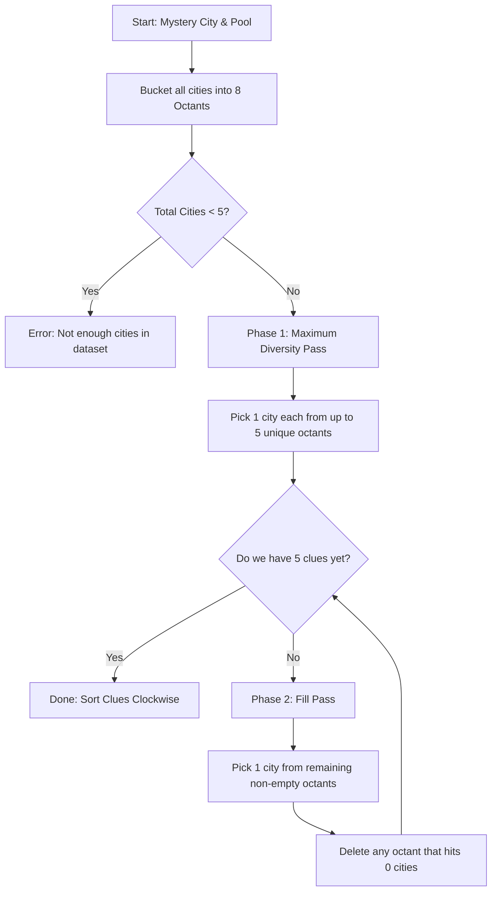

# GeoCentric Clue Finding Algorithm: Deep Dive

This document breaks down the **Capacity-Aware Angular Diversity Algorithm** implemented in [`prototype.py`](file:///run/media/cosmos/Data/mridul/codes/GeoCentric/prototype.py).

---

## 1. The Problem We Are Solving

Given:
* A **Target Mystery City** $C^*$ (e.g., Mumbai).
* A **Candidate Pool** of cities (e.g., Top 50 Indian cities).
* A requested number of clues $K = 5$.

We want to find $K$ distinct cities such that their compass directions (bearings) **spread out across the compass** as evenly as possible, avoiding bunching up in one direction.

---

## 2. The Mental Model: Buckets of Cities

Imagine 8 physical buckets labeled with the 8 compass directions:
`0: N`, `1: NE`, `2: E`, `3: SE`, `4: S`, `5: SW`, `6: W`, `7: NW`.

Every city in the pool is dropped into the bucket corresponding to its bearing from Mumbai:
* **Surat** $\rightarrow$ `Bucket 0 (N)`
* **Varanasi, Patna** $\rightarrow$ `Bucket 1 (NE)`
* **Bhubaneswar, Kolkata** $\rightarrow$ `Bucket 2 (E)`
* **Pune, Bengaluru, Chennai** $\rightarrow$ `Bucket 3 (SE)`
* **Panaji, Kochi** $\rightarrow$ `Bucket 4 (S)`
* *Arabian Sea* $\rightarrow$ `Bucket 5 (SW)` is **EMPTY**
* *Arabian Sea* $\rightarrow$ `Bucket 6 (W)` is **EMPTY**
* *Arabian Sea* $\rightarrow$ `Bucket 7 (NW)` is **EMPTY**

---

## 3. What Was Wrong With The Previous Approach?

In the first draft, we tried to pick **5 bucket numbers** first, and then draw cities from them later:

```python
# PREVIOUS FLAWED CODE
chosen_octants = list(available_octants)
while len(chosen_octants) < num_clues:
    chosen_octants.append(random.choice(available_octants))
```

### The Failure Case (The Edge Case You Noticed!):
Suppose you are in a corner of India with only 3 directions with cities:
* `Bucket 0 (N)` has **1 city** (Surat).
* `Bucket 1 (NE)` has **10 cities**.
* `Bucket 2 (E)` has **10 cities**.

`available_octants` is `[0, 1, 2]`.
If `random.choice([0, 1, 2])` picks `0` twice, `chosen_octants` becomes:
`[0, 1, 2, 0, 1]`.

When we later try to pull a city for the **second** `0`:
* `Bucket 0` is already empty!
* The algorithm either crashes, picks a duplicate city, or needs messy fallback code.

---

## 4. The New Architecture: Two-Phase Capacity-Aware Sampling

Instead of picking *abstract bucket numbers*, we treat each bucket as a **live inventory**. When a city is taken, the bucket's inventory shrinks. When a bucket reaches 0, it is **deleted from the list of choices**.



---

## 5. Step-by-Step Code Walkthrough

### Step A: Total Capacity Guard
```python
total_available_cities = sum(len(cities) for cities in octant_buckets.values())
if total_available_cities < num_clues:
    raise ValueError(f"Not enough cities! Only found {total_available_cities}.")
```
* **CS Principle (Fail Fast):** If the whole database only has 3 cities, you can never pick 5 unique clues. Catch this immediately before doing any work.

---

### Step B: The Atomic Helper Function (`pick_city_from_octant`)
```python
remaining_pools = {o: list(cities) for o, cities in octant_buckets.items() if len(cities) > 0}

def pick_city_from_octant(octant: int) -> dict:
    city = random.choice(remaining_pools[octant])  # 1. Pick a random city
    remaining_pools[octant].remove(city)           # 2. Remove it (no duplicates)
    if len(remaining_pools[octant]) == 0:
        del remaining_pools[octant]                # 3. DELETE bucket if empty!
    return city
```
* **Why this is critical:** The moment a bucket runs out of cities, `del remaining_pools[octant]` removes that key from the dictionary.
* When we later ask for `list(remaining_pools.keys())`, empty buckets **cannot be chosen**, making infinite loops impossible!

---

### Step C: Phase 1 — Maximum Directional Diversity
```python
available_octants = list(remaining_pools.keys())

if len(available_octants) >= num_clues:
    # We have 5 or more directions: pick 5 DIFFERENT directions
    first_pass_octants = random.sample(available_octants, num_clues)
else:
    # Fewer than 5 directions: take 1 city from EVERY direction we have
    first_pass_octants = list(available_octants)

for octant in first_pass_octants:
    selected_clues.append(pick_city_from_octant(octant))
```
* **Example:** If Mumbai has cities in `[N, NE, E, SE, S]` (5 octants), Phase 1 takes 1 city from each. We now have 5 clues pointing in 5 distinct directions!

---

### Step D: Phase 2 — Safe Fill Pass (Only if Phase 1 had < 5 directions)
Suppose a city only had 3 directions (`N`, `NE`, `E`). After Phase 1, we have 3 clues. We still need 2 more:

```python
while len(selected_clues) < num_clues:
    eligible_octants = list(remaining_pools.keys())
    chosen_octant = random.choice(eligible_octants)
    selected_clues.append(pick_city_from_octant(chosen_octant))
```
* `eligible_octants` **only** contains octants that still have $\ge 1$ city left.
* If `N` only had 1 city, Phase 1 took it and `del remaining_pools['N']` removed it.
* So `eligible_octants` in Phase 2 is only `['NE', 'E']`.
* It safely picks from `NE` or `E` without ever touching `N` again!

---

## 6. Mathematical Guarantees

1. **Termination Guarantee:** The `while` loop must terminate because:
   * Every iteration removes 1 city from `remaining_pools`.
   * Total cities $\ge 5$, so there is always at least one eligible city until `len(selected_clues) == 5`.
2. **No Duplicates:** Every city picked is removed from its pool immediately.
3. **Maximal Angular Spread:** It is mathematically impossible to have two clues in the same direction if an unused direction was available.
